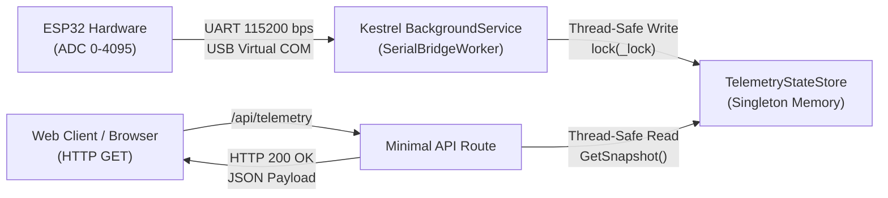

# ใบงานการทดลองที่ 8.3 (Labsheet 8.3)
### สะพานเชื่อมฮาร์ดแวร์จริงสู่เว็บเซิร์ฟเวอร์ (Hardware Serial Bridge)

**รหัสนักศึกษา:** 67030281  
**ชื่อ-นามสกุล:** นายชนินทร์ คำวงศ์ษา

---

## วัตถุประสงค์การทดลอง (Objectives)
1. สามารถติดตั้งแพ็กเกจ `System.IO.Ports` ลงในโปรเจกต์ .NET ผ่าน CLI ได้
2. สามารถสร้างและกำหนดค่า `BackgroundService` เพื่อทำงานดักรับข้อมูลแบบ Non-blocking เธรดเบื้องหลังได้
3. เข้าใจการสร้างคลาสเก็บสถานะข้อมูลแบบปลอดภัยต่อการเข้าถึงพร้อมกัน (Thread-Safe Shared State)
4. สามารถเชื่อมโยงข้อมูลจากสาย USB สู่ Web Endpoint `/api/telemetry` ได้อย่างสมบูรณ์
5. ทดสอบการทำงานของ Dual-Mode System: ระบบสลับสู่โหมดจำลอง (Simulator) อัตโนมัติเมื่อถอดสาย

---

## แผนภาพการทำงานของระบบ (System Architecture)



---

## โครงสร้างซอร์สโค้ด (`Lab8-3/Kestrel_Serial_Gateway/Program.cs`)

```csharp
using System.IO.Ports;

var builder = WebApplication.CreateBuilder(args);

// ลงทะเบียน TelemetryStateStore เป็น Singleton (มี Instance เดียวตลอดการทำงาน)
builder.Services.AddSingleton<TelemetryStateStore>();

// ลงทะเบียน SerialBridgeWorker เป็น Background Hosted Service
builder.Services.AddHostedService<SerialBridgeWorker>();

var app = builder.Build();

// Endpoint หน้าแรก
app.MapGet("/", () => "IoT Edge Gateway Online! Visit /api/telemetry to view live data.");

// Endpoint สำหรับดึงค่า Telemetry ล่าสุด (พร้อม Micro-Challenge: alertLevel)
app.MapGet("/api/telemetry", (TelemetryStateStore state) => {
    var (raw, voltage, percent, source, updated) = state.GetSnapshot();
    
    // ตรวจสอบ alertLevel ตามเงื่อนไข Micro-Challenge
    string alertLevel = percent switch
    {
        > 85.0 => "DANGER (HIGH)",
        >= 70.0 => "WARNING",
        _ => "NORMAL"
    };

    return Results.Ok(new {
        sensor = "ESP32-Potentiometer",
        rawValue = raw,
        voltage = voltage,
        percentage = percent,
        alertLevel = alertLevel,
        dataSource = source,
        timestamp = updated.ToString("yyyy-MM-ddTHH:mm:ss.fffZ")
    });
});

app.Run();

// ============================================================================
// 1. THREAD-SAFE STATE STORE (คลังเก็บค่าสถานะกลาง)
// ============================================================================
public class TelemetryStateStore
{
    private readonly object _lock = new();
    private int _rawValue = 0;
    private DateTime _lastUpdated = DateTime.UtcNow;
    private string _source = "Initializing";

    public void Update(int rawValue, string source)
    {
        lock (_lock)
        {
            _rawValue = Math.Clamp(rawValue, 0, 4095);
            _source = source;
            _lastUpdated = DateTime.UtcNow;
        }
    }

    public (int raw, double voltage, double percent, string source, DateTime updated) GetSnapshot()
    {
        lock (_lock)
        {
            double voltage = Math.Round((_rawValue / 4095.0) * 3.3, 2);
            double percent = Math.Round((_rawValue / 4095.0) * 100.0, 1);
            return (_rawValue, voltage, percent, _source, _lastUpdated);
        }
    }
}

// ============================================================================
// 2. BACKGROUND WORKER (อ่านข้อมูล Serial จาก ESP32 พร้อม Fallback Simulation)
// ============================================================================
public class SerialBridgeWorker : BackgroundService
{
    private readonly TelemetryStateStore _stateStore;
    private readonly ILogger<SerialBridgeWorker> _logger;

    public SerialBridgeWorker(TelemetryStateStore stateStore, ILogger<SerialBridgeWorker> logger)
    {
        _stateStore = stateStore;
        _logger = logger;
    }

    protected override async Task ExecuteAsync(CancellationToken stoppingToken)
    {
        await Task.Yield();
        _logger.LogInformation("🚀 [Worker] Serial Bridge Background Service Started");

        while (!stoppingToken.IsCancellationRequested)
        {
            string[] availablePorts = SerialPort.GetPortNames();

            if (availablePorts.Length > 0)
            {
                _logger.LogInformation("📋 รายการ COM Ports: [{Ports}]", string.Join(", ", availablePorts));

                string targetPort = availablePorts.FirstOrDefault(p => !p.Equals("COM1", StringComparison.OrdinalIgnoreCase)) ?? availablePorts[0];
                _logger.LogInformation("🔌 กำลังเชื่อมต่อพอร์ต: {Port}", targetPort);

                try
                {
                    using var serial = new SerialPort(targetPort, 115200)
                    {
                        ReadTimeout = 2000,
                        DtrEnable = true,
                        RtsEnable = true
                    };
                    serial.Open();
                    serial.DiscardInBuffer();
                    _logger.LogInformation("✅ เชื่อมต่อฮาร์ดแวร์สำเร็จบน {Port} (Live Mode)", targetPort);

                    while (!stoppingToken.IsCancellationRequested && serial.IsOpen)
                    {
                        try
                        {
                            if (serial.BytesToRead > 0)
                            {
                                string line = serial.ReadLine().Trim();
                                if (int.TryParse(line, out int val))
                                {
                                    _stateStore.Update(val, $"Live Hardware ({targetPort})");
                                }
                            }
                            else
                            {
                                await Task.Delay(50, stoppingToken);
                            }
                        }
                        catch (TimeoutException)
                        {
                            await Task.Delay(50, stoppingToken);
                        }
                    }
                }
                catch (Exception ex)
                {
                    _logger.LogWarning("⚠️ ไม่สามารถเปิด {Port} ({Msg}) -> สลับเข้าโหมดจำลอง", targetPort, ex.Message);
                }
            }
            else
            {
                _logger.LogInformation("🔍 ไม่พบพอร์ต USB -> ทำงานในโหมดจำลอง (Simulation Mode)");
            }

            // Fallback Simulation Mode (คลื่น Sine Wave)
            for (int i = 0; i < 20 && !stoppingToken.IsCancellationRequested; i++)
            {
                double t = Environment.TickCount64 / 1000.0;
                int simAdc = (int)((Math.Sin(t * 1.5) + 1.0) / 2.0 * 4095);
                _stateStore.Update(simAdc, "Simulation Mode (Sine Wave)");
                await Task.Delay(100, stoppingToken);
            }
        }
    }
}
```

---

## [Checkpoint 3.1: ทดสอบกลไก Fallback Simulation]

### การทดลอง:
1. ขณะที่โปรแกรม C# Kestrel กำลังรันและรับค่าจาก ESP32 อยู่ ให้ทำการถอดสาย USB ของ ESP32 ออกจากเครื่องคอมพิวเตอร์
2. กด Refresh (F5) บนหน้าเว็บเบราว์เซอร์ที่ URL `http://localhost:5000/api/telemetry` หลายๆ ครั้งติดต่อกัน

### ผลการสังเกตและตอบคำถาม:
1. **ค่า `dataSource` เปลี่ยนเป็นอะไร?**
   - **คำตอบ:** เปลี่ยนจาก `"Live Hardware (COM24)"` กลายเป็น **`"Simulation Mode (Sine Wave)"`** ครับ
2. **ค่า `rawValue` ยังเปลี่ยนได้อยู่หรือไม่ และเปลี่ยนในลักษณะใด?**
   - **คำตอบ:** ยังเปลี่ยนได้อยู่เรื่อยๆ ครับ โดยค่ามันจะไม่ได้ค้างหรือกลายเป็นศูนย์ แต่จะแกว่งขึ้นๆ ลงๆ เป็นลูกคลื่น Sine Wave วิ่งสลับไปมาระหว่าง 0 ถึง 4095 ไปเรื่อยๆ ครับ เพราะในโค้ดมีระบบ Fallback ช่วยจำลองค่าให้ ทำให้หน้าเว็บหรือโปรแกรมที่มารับข้อยังทำงานต่อได้แบบไม่ล่ม แม้ว่าเราจะถอดสายบอร์ดออกไปแล้วครับ

---

## 🎯 ภารกิจท้าทาย (Micro-Challenge) การเพิ่มฟิลด์ `alertLevel`

### 1. เงื่อนไขการทำงาน
- เมื่อ percentage > 85.0% กำหนดเป็น `"DANGER (HIGH)"`
- เมื่อ percentage อยู่ระหว่าง 70.0% ถึง 85.0% กำหนดเป็น `"WARNING"`
- เมื่อ percentage ต่ำกว่า 70.0% กำหนดเป็น `"NORMAL"`

### 2. ผลลัพธ์ JSON ในแต่ละระดับการทดสอบ

#### กรณีที่ 1: ระดับปกติ (NORMAL: ค่าต่ำกว่า 70%)
```json
{
  "sensor": "ESP32-Potentiometer",
  "rawValue": 1850,
  "voltage": 1.49,
  "percentage": 45.2,
  "alertLevel": "NORMAL",
  "dataSource": "Simulation Mode (Sine Wave)",
  "timestamp": "2026-11-05T20:49:15.123Z"
}
```

#### กรณีที่ 2: ระดับเตือนภัย (WARNING: ค่าระหว่าง 70% ถึง 85%)
```json
{
  "sensor": "ESP32-Potentiometer",
  "rawValue": 3150,
  "voltage": 2.54,
  "percentage": 76.9,
  "alertLevel": "WARNING",
  "dataSource": "Live Hardware (COM24)",
  "timestamp": "2026-11-05T20:50:02.456Z"
}
```

#### กรณีที่ 3: ระดับอันตราย (DANGER (HIGH): ค่าเกิน 85%)
```json
{
  "sensor": "ESP32-Potentiometer",
  "rawValue": 3890,
  "voltage": 3.13,
  "percentage": 95.0,
  "alertLevel": "DANGER (HIGH)",
  "dataSource": "Live Hardware (COM24)",
  "timestamp": "2026-11-05T20:50:35.789Z"
}
```
